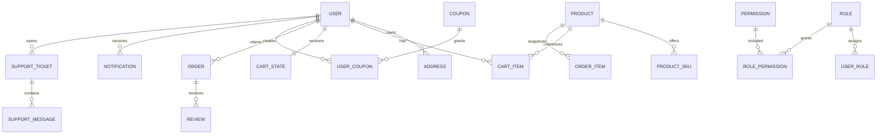

# 数据模型与迁移

## 数据库

生产数据库使用 MySQL 8，连接配置见[开发指南](development.md)。GORM 在服务启动时执行自动迁移；金额迁移和购物车重复行清理在 `AutoMigrate` 之前执行。生产变更仍建议先备份并在维护窗口执行。

## 表清单

| 表 | 模型 | 作用 |
| --- | --- | --- |
| `products` | `Product` | 商品目录、价格、库存、上下架和精选 |
| `shop_product_skus` | `ProductSku` | 商品规格、规格价格和独立库存 |
| `shop_categories` | `Category` | 商品分类 |
| `shop_users` | `User` | 用户、bcrypt 密码哈希和资料 |
| `shop_addresses` | `Address` | 用户收货地址 |
| `shop_cart_items` | `CartItem` | 用户购物车行 |
| `shop_cart_states` | `CartState` | 购物车版本号，串行化跨设备写入 |
| `shop_checkout_requests` | `CheckoutRequest` | 结算请求幂等回执 |
| `shop_orders` | `Order` | 订单、收货快照、金额、状态、物流和售后 |
| `shop_coupons` | `Coupon` | 优惠券规则和有效期 |
| `shop_user_coupons` | `UserCoupon` | 用户领取券及核销状态 |
| `shop_reviews` | `Review` | 订单商品评价 |
| `shop_notifications` | `Notification` | 站内订单/优惠券通知 |
| `shop_support_tickets` | `SupportTicket` | 客服咨询和人工转接状态 |
| `shop_support_messages` | `SupportMessage` | 客服会话消息 |
| `shop_roles` | `Role` | RBAC 角色 |
| `shop_permissions` | `Permission` | RBAC 权限点 |
| `shop_user_roles` | `UserRole` | 用户与角色关系 |
| `shop_role_permissions` | `RolePermission` | 角色与权限关系 |
| `shop_migrations` | 内部迁移记录 | 一次性历史迁移幂等标记 |

## 核心关系



`Order.Items` 使用 JSON 序列化保存订单商品快照，包含商品 ID、SKU、规格、成交价、数量和展示信息。订单生成后不依赖商品当前名称或价格展示历史成交信息。

## 金额和库存

- `model.Price` 是整数分类型，禁止用浮点数参与最终结算。
- 商品无 SKU 时使用 `products.stock`；有 SKU 时使用 `shop_product_skus.stock`。
- 创建订单时软校验库存；支付成功时在事务中真正扣库存、增加销量并核销优惠券。
- 退款、取消和售后根据订单生命周期恢复库存/销量/优惠券，重复请求由生命周期版本和固定请求号保护。

## 购物车约束

`shop_cart_items` 对 `(user_id, product_id, sku_id)` 建立唯一索引。每行数量限制为 1–999，单个购物车最多 100 行。`sku_id` 使用 0 表示无规格。

`CartState.Version` 用于拒绝过期的全量写入；`CheckoutRequest` 以 `(user_id, request_id)` 为主键，保证网络重试不会生成第二笔订单。购物车结算会在一个数据库事务内完成：校验版本、重算价格、校验库存/优惠券/地址、创建订单、扣除购物车数量和记录回执。

## 启动迁移顺序

1. 连接 MySQL；目标库不存在时尝试创建 `MYSQL_DATABASE`。
2. 执行金额从元到分的历史迁移，使用 `shop_migrations` 幂等记录。
3. 清理购物车非法行、重复行和超过 999 的数量。
4. 自动迁移购物车状态、结算回执及其他模型。
5. 执行订单生命周期字段迁移。
6. 空目录时写入默认商品、分类、优惠券；补齐角色、权限和管理员关联。

## 独立购物车迁移工具

```powershell
go run ./cmd/cart-migrate
go run ./cmd/cart-migrate -apply
```

工具只检查/迁移购物车相关表，使用 MySQL 命名锁。业务购物车非空时，`-apply` 会先创建 `shop_cart_backup_<timestamp>` 备份表。详细说明和真实 MySQL 验证命令见[购物车一致性](cart-consistency.md)。
