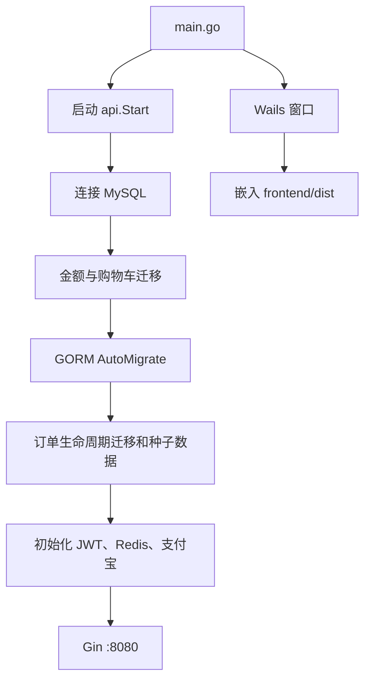
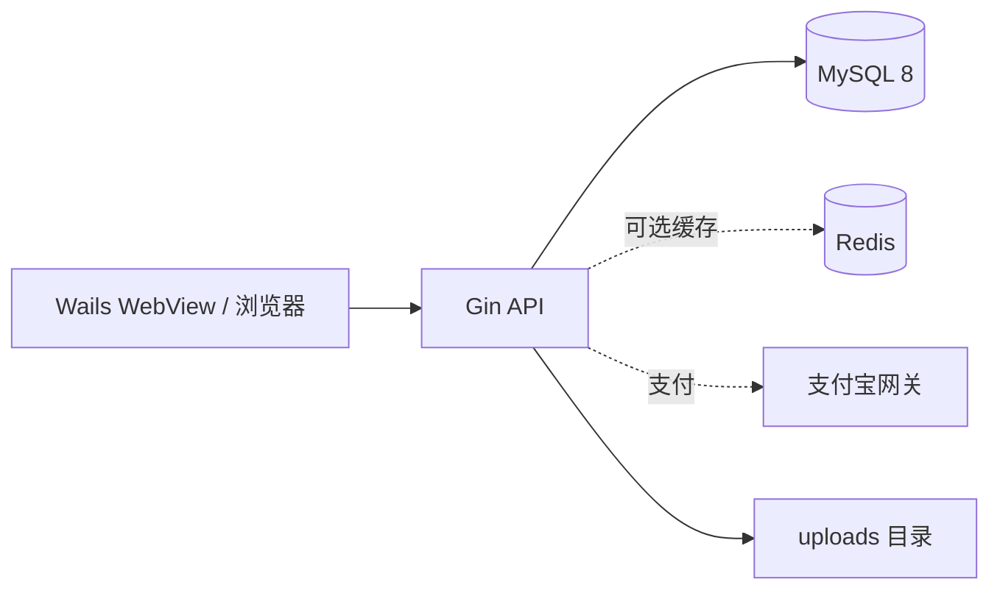

# 项目总览

## 产品范围

项目由一个 Wails 3 桌面客户端和一个 Gin HTTP 服务组成。桌面端嵌入 Vue 前端；服务端负责认证、目录、订单、支付、库存、优惠券、客服、通知和管理后台接口。服务端也可以用 `server` 构建标签独立部署，不依赖桌面窗口。

## 技术栈

| 层次 | 技术 | 用途 |
| --- | --- | --- |
| 桌面壳 | Wails 3 beta | 嵌入前端、生成桌面/移动端构建产物 |
| 前端 | Vue 3 + TypeScript + Vite | 用户端和管理后台 |
| UI | Vant 4 | 移动端组件、表单、弹层、订单交互 |
| 状态 | Pinia | 用户、购物车、通知状态 |
| HTTP | Axios | 前端 API 请求与鉴权头 |
| 后端 | Go 1.26 + Gin | HTTP 路由、中间件和业务处理 |
| ORM | GORM + MySQL driver | MySQL 访问、自动迁移和事务 |
| 数据库 | MySQL 8 | 用户、商品、订单和业务数据 |
| 缓存 | go-redis/v9 | 商品目录缓存、权限缓存、限流计数 |
| 支付 | 支付宝当面付 | 预下单、支付查询、关单、退款和异步通知 |
| 测试 | Go test + Node test + happy-dom | 后端业务测试和前端组件测试 |

## 目录结构

```text
.
├── main.go                    # Wails 桌面入口，嵌入 frontend/dist
├── internal/
│   ├── api/                   # Gin 路由、处理器、支付、订单、缓存和迁移
│   ├── auth/                  # JWT 登录、注册和认证配置
│   ├── database/              # MySQL DSN、建库和连接
│   ├── model/                 # GORM 数据模型和金额类型
│   ├── redisx/                # Redis 客户端及不可用降级
│   └── logx/                  # 日志初始化
├── frontend/
│   ├── src/views/             # 用户端和管理后台页面
│   ├── src/components/        # 购物车数量、编辑器、客服等复用组件
│   ├── src/stores/            # 用户、购物车、通知 Pinia store
│   ├── src/router/            # 用户端和 admin 路由、登录守卫
│   └── tests/                 # 前端回归测试
├── cmd/cart-migrate/          # 独立购物车 MySQL 检查/迁移工具
├── service/                   # Wails 暴露的二维码、问候服务
├── migrations/                # 历史 SQL 迁移文件
├── build/                     # Wails、Docker 和各平台 Taskfile
├── docs/                      # 项目、接口、数据和运维文档
└── uploads/                   # 本地上传文件目录，生产环境需持久化
```

## 启动流程



数据库不可用时，服务端会记录错误并保留目录兜底能力；需要用户、订单、购物车等数据库功能时必须恢复 MySQL。Redis 初始化失败不会阻止服务启动。

## 前端功能分区

用户端页面包括首页、分类、搜索、商品详情、购物车、确认订单、收货地址、优惠券、订单列表/详情、收银台、评价、通知、客服和个人资料。需要登录的页面由路由 `meta.requiresAuth` 保护。

管理后台位于 `/admin`，菜单按权限显示：概览、商品、分类、订单、客服、用户、优惠券、通知、评价、权限和角色。服务端再次使用权限中间件校验，前端隐藏菜单不构成安全边界。

## 关键请求链路

### 浏览商品

前端请求 `/api/categories`、`/api/products` 或 `/api/products/:id`。服务端优先读取 Redis 目录缓存，缓存未命中或 Redis 不可用时查 MySQL，并在成功后回填缓存。商品或分类后台发生变化时会失效对应缓存。

### 登录与通知

登录接口返回 JWT。Axios 请求拦截器将 token 放入 `Authorization: Bearer ...`。应用初始化后校验 `/api/me`，登录状态变化会连接通知 SSE；通知也会持久化到 MySQL，可在 SSE 断开后重新拉取。

### 下单与支付

购物车先用版本号同步到服务端，确认订单时服务端重新读取商品、规格、库存、优惠券和地址。订单创建成功后进入待付款；收银台调用支付宝预下单，页面轮询支付状态，后台定时补查待付款订单。支付成功后在事务中扣库存、增加销量、核销优惠券。

### 售后与客服

用户提交整单售后申请后，商家在后台处理退款、退货地址、验收和原路退款。客服默认由内置规则自动应答，用户明确发送“联系人工”后进入人工队列，人工回复会生成站内通知。

## 进程和依赖关系



MySQL 是业务数据唯一来源；Redis 可清空后重建。上传目录保存头像、商品图片等文件，数据库只保存路径或 URL。

